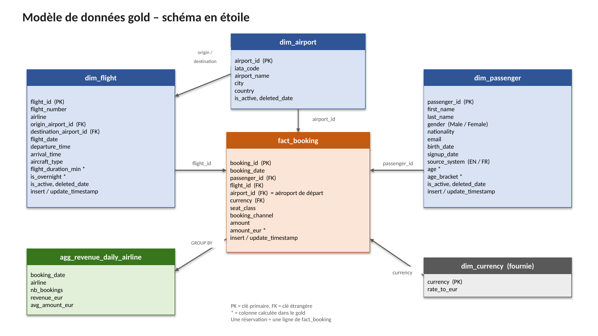

# Documentation du TP d'ingénierie des données

Oumou MARIKO, 5A ISia. J'ai fait le TP seule.

## Comment lancer le projet

```bash
python3 -m venv venv
source venv/bin/activate
pip install -r requirements.txt
python3 ingestion/run_month.py
```

Ça prend à peu près une minute, parce qu'il faut télécharger les 155 fichiers. À la fin, il y a
le dossier `bronze/` avec les fichiers bruts et la base `warehouse.duckdb`.

## Ce que j'ai vu dans les données

Avant de coder, j'ai ouvert les fichiers de `init/` et ceux des premiers jours de septembre pour
comprendre comment ils changent d'un jour à l'autre.

- Chaque fichier a une colonne qui identifie une ligne : `airport_id`, `flight_id`,
  `passenger_id` (`id_passager` dans le fichier français) et `booking_id`.
- Pour les aéroports, les vols et les passagers, le fichier du jour contient toutes les lignes,
  pas seulement les nouvelles.
- Pour les réservations, c'est l'inverse : le fichier du jour contient seulement les réservations
  de ce jour-là.
- Les aéroports ne changent presque jamais. Les vols changent souvent et certains disparaissent
  du fichier. Il y a de nouveaux passagers presque tous les jours, et quelques-uns disparaissent.
- Les deux fichiers passagers n'ont pas le même format. Les noms de colonnes sont différents, le
  genre est écrit `Male/Female` dans l'un et `Homme/Femme` dans l'autre, et les dates sont écrites
  `2001-05-14` dans l'un et `14/05/2001` dans l'autre. Par contre, un même passager n'est jamais
  dans les deux fichiers.
- Dans le fichier de départ, 117 vols sur 420 ont une heure d'arrivée avant l'heure de départ.
  Ce sont des vols qui arrivent le lendemain.
- Le `airport_id` d'une réservation est toujours l'aéroport de départ du vol réservé.

## Table de fait et dimensions

Une réservation est quelque chose qui s'est passé à un moment précis. Une fois faite, elle ne
change plus. C'est pour ça que j'en ai fait la table de fait, `fact_booking`. Une ligne de cette
table, c'est une réservation.

Les vols, les passagers et les aéroports servent à décrire une réservation : qui a réservé, sur
quel vol, au départ de quel aéroport. Leurs informations peuvent changer avec le temps. Par
exemple un vol change d'horaire, ou un passager change d'email. Ce sont donc les dimensions.

## Le modèle gold

C'est un schéma en étoile, avec `fact_booking` au centre et les dimensions autour.



Le même schéma est dans `docs/modele_donnees.pptx`.

- `fact_booking` : les réservations, avec le montant et les identifiants du vol, du passager, de
  l'aéroport et de la devise. J'ai laissé `seat_class` et `booking_channel` dans cette table. Ils
  n'ont que 4 valeurs possibles chacun, donc une table à part n'apportait rien.
- `dim_flight` : les vols. J'ajoute la durée du vol (`flight_duration_min`) et une colonne
  `is_overnight` qui dit si le vol arrive le lendemain.
- `dim_passenger` : les passagers des deux fichiers réunis. J'ajoute l'âge (`age`) et la tranche
  d'âge (`age_bracket`).
- `dim_airport` : les aéroports. C'est le code donné dans le sujet.
- `dim_currency` : les taux de change. Cette table est fournie.
- `agg_revenue_daily_airline` : le chiffre d'affaires en euros et le nombre de réservations, par
  jour et par compagnie.

### Les colonnes que je calcule

- La durée du vol : je fais l'heure d'arrivée moins l'heure de départ, en minutes. Si l'arrivée
  est avant le départ, le vol arrive le lendemain, donc j'ajoute 24 heures.
- L'âge et la tranche d'âge : je calcule l'âge au 30 septembre 2025, le dernier jour des données.
  J'ai pris une date fixe pour que le résultat reste le même chaque fois qu'on relance le projet.
  Les tranches sont `<18`, `18-24`, `25-34`, `35-44`, `45-54`, `55-64` et `65+`.
- Le montant en euros : `amount_eur = amount * rate_to_eur`. Je prends le taux dans
  `dim_currency`.

### Où je construis la table d'agrégation

Je la construis dans le `ingest_gold` des réservations, juste après `fact_booking`. Elle a besoin
de `fact_booking` et de `dim_flight`, pour avoir le nom de la compagnie. Dans `run_month.py`, le
gold des réservations passe en dernier, donc `dim_flight` est déjà à jour à ce moment-là.

## Insert ou upsert

### Aéroports, vols et passagers : upsert

Le fichier du jour contient toutes les lignes. Je le compare donc avec ce que j'ai déjà dans la
table.

- Si la ligne n'existe pas encore, je l'ajoute.
- Si elle existe déjà, je la mets à jour.
- Si une ligne de la table n'est plus dans le fichier, je ne la supprime pas. Je mets `is_active`
  à `false` et j'écris la date dans `deleted_date`.

Je ne supprime jamais une ligne, parce que des réservations en ont besoin. À la fin du mois,
18 vols ont disparu des fichiers et 774 réservations ont été faites sur ces vols. Si je
supprimais ces vols, ces réservations ne seraient plus reliées à aucun vol.

C'est la même méthode que dans `ingest_airports.py`. Je l'ai reprise pour les vols et pour les
passagers.

### Réservations : insert

Le fichier du jour contient seulement de nouvelles réservations, et une réservation ne change
jamais. Il n'y a donc rien à mettre à jour et rien à désactiver : j'ajoute les lignes, c'est
tout. J'ai mis `ON CONFLICT DO NOTHING` pour qu'on puisse relancer le même jour deux fois sans
avoir de lignes en double.

### Les deux fichiers passagers

Dans `ingest_silver`, je mets le fichier français au même format que le fichier anglais. Je
renomme les colonnes, je remplace `Homme/Femme` par `Male/Female` et j'écris les dates de la même
façon. Ensuite je réunis les deux fichiers dans une seule table, `silver_passengers`. J'ai ajouté
une colonne `source_system` (`EN` ou `FR`) pour savoir de quel fichier vient chaque passager.

### Les colonnes techniques

Toutes mes tables silver et gold ont `insert_timestamp` et `update_timestamp`. La première garde
le moment où la ligne a été vue pour la première fois, et ne change plus. La deuxième change
chaque fois que la ligne est mise à jour ou désactivée.

## Mes verifications

Ces chiffres viennent des données telles qu'elles étaient le 25/09/2026. Le dépôt des données a
été modifié pendant le TP, donc si elles changent encore, les chiffres changeront aussi.

- Le projet tourne du début à la fin sans erreur. Je l'ai testé sur deux ordinateurs, en
  repartant d'un clone propre.
- À la fin j'ai 81 aéroports, 714 vols dont 18 désactivés, 2 221 passagers dont 7 désactivés, et
  38 930 réservations.
- Aucune réservation n'est reliée à un vol, un passager ou un aéroport qui n'existe pas.
- Si je relance le dernier jour une deuxième fois, je n'ai pas de lignes en double et les
  chiffres restent les mêmes.
- Les 9 requêtes de `sql/analysis/queries_analyse.sql` fonctionnent sur mon modèle.

## Les limites du tp

- Je garde seulement la dernière version d'un vol ou d'un passager. Si un vol change d'horaire,
  je n'ai plus l'ancien horaire. Pour garder l'historique, il faudrait faire le SCD2 vu en cours.
  C'est le bonus et je ne l'ai pas fait.
- `update_timestamp` change à chaque passage, même quand les valeurs sont restées les mêmes. Le
  code fourni pour les aéroports marche comme ça et j'ai gardé la même logique.
- Il faut rejouer les jours dans l'ordre. Si on rejoue un ancien jour après un jour plus récent,
  les tables reviennent à l'ancien état.
- Les taux de change sont fixes, donc le montant en euros n'est pas exact.
- L'âge est calculé à une date fixe, et pas à la date de la réservation.
- Je n'ai pas fait de table pour les dates. Les fonctions de date de DuckDB suffisent pour les
  analyses demandées.
